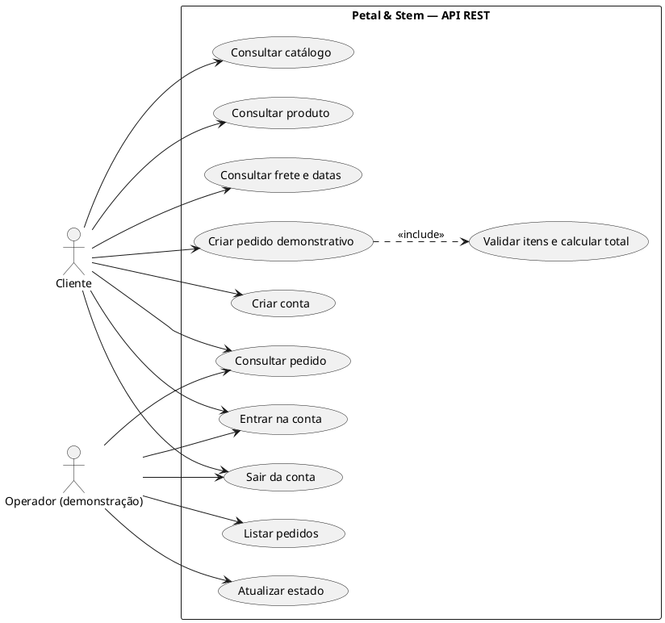
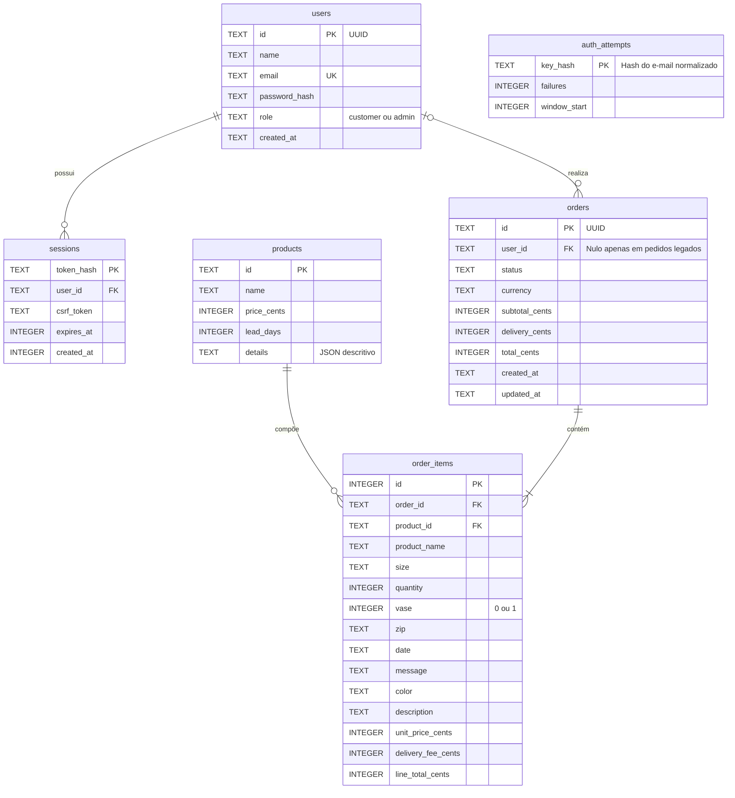
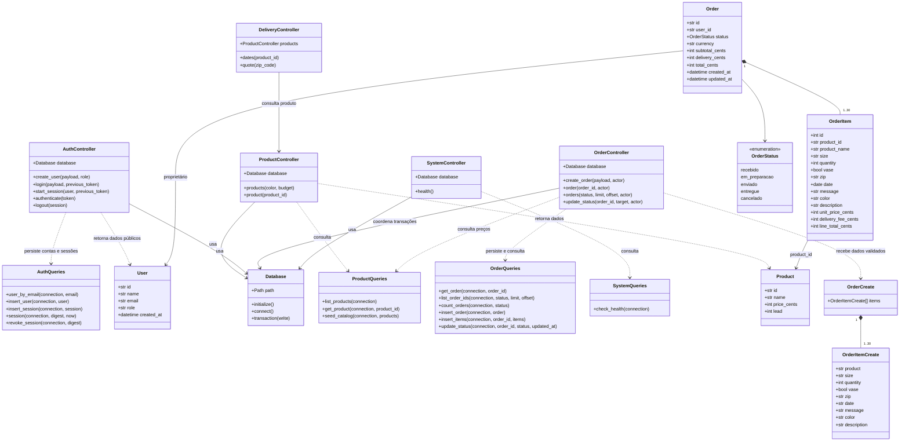
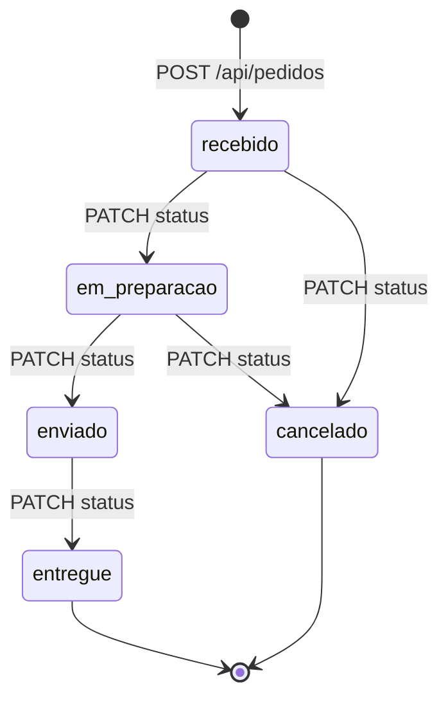
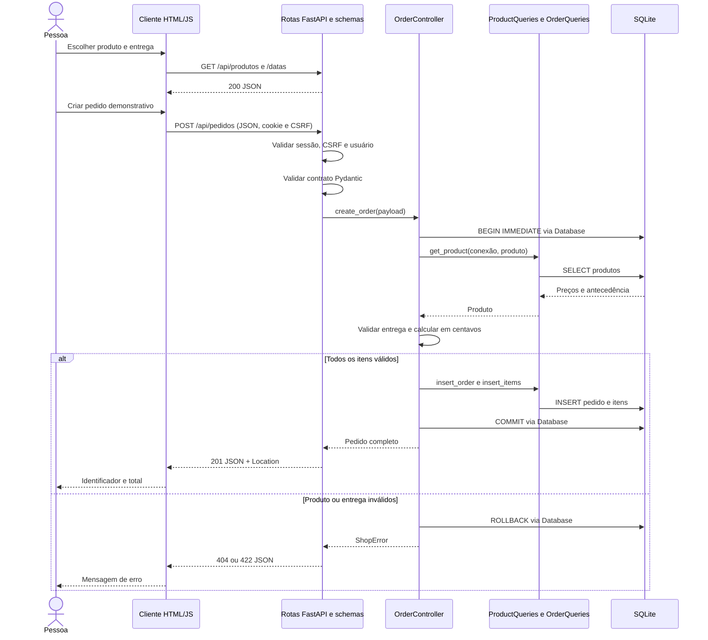

# Diagramas — Petal & Stem

O escopo destes artefatos é o backend e o cliente REST local em `/cliente`.
O cliente pode consultar produtos, criar e acompanhar pedidos e demonstrar a
atualização dos estados. Não há pagamento nem entrega real. O cliente precisa
entrar na conta para criar ou consultar seus pedidos. O administrador consulta
todos os pedidos e atualiza as etapas; o cliente pode cancelar os próprios
pedidos antes do envio. O catálogo permanece público.

## Casos de uso (UML em PlantUML)

O bloco abaixo usa a notação de casos de uso do PlantUML. Para gerar uma imagem,
abra-o em um renderizador PlantUML; editores sem esse suporte mostrarão o código.

## DER (Mermaid)

As entidades correspondem às tabelas de `backend/schema.sql`. `details` guarda
os atributos descritivos do produto como JSON; os preços e os relacionamentos
que participam das regras são colunas próprias. O nome e os valores no item
preservam o histórico da compra.

Todo pedido novo recebe o usuário autenticado como proprietário. A relação
opcional com `users` existe para preservar pedidos anteriores à autenticação;
esses pedidos são visíveis apenas a administradores. `auth_attempts` controla
tentativas por hash do e-mail, inclusive quando a conta não existe, sem relação
obrigatória com `users`. As sessões expiram após oito horas e são revogadas no logout.

## Classes (Mermaid)

Diagrama simplificado das classes implementadas. Os schemas de saída são
modelos Pydantic, e a persistência usa SQL parametrizado, sem ORM. As rotas
delegam aos controllers, que usam queries e a infraestrutura `Database`.

## Transição de estados (Mermaid)

Transições não desenhadas retornam HTTP 409. Repetir o estado atual retorna
HTTP 200 sem alteração. A leitura do estado e sua atualização são realizadas
na mesma transação SQLite para evitar transições concorrentes inconsistentes.

## Sequência de criação de pedido (Mermaid)

